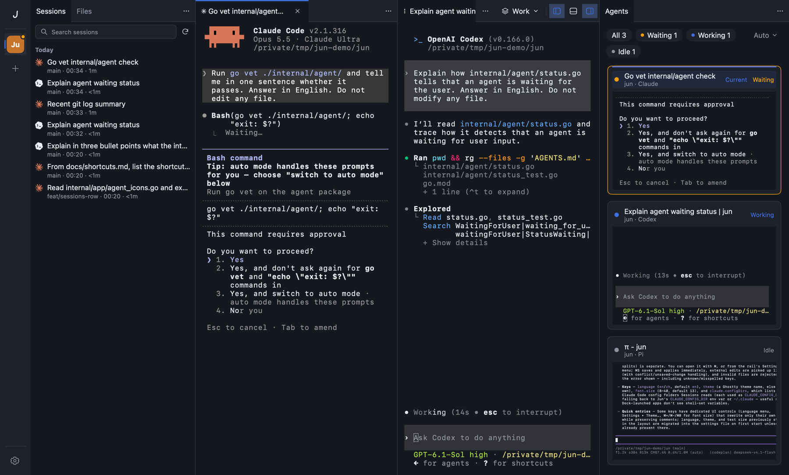
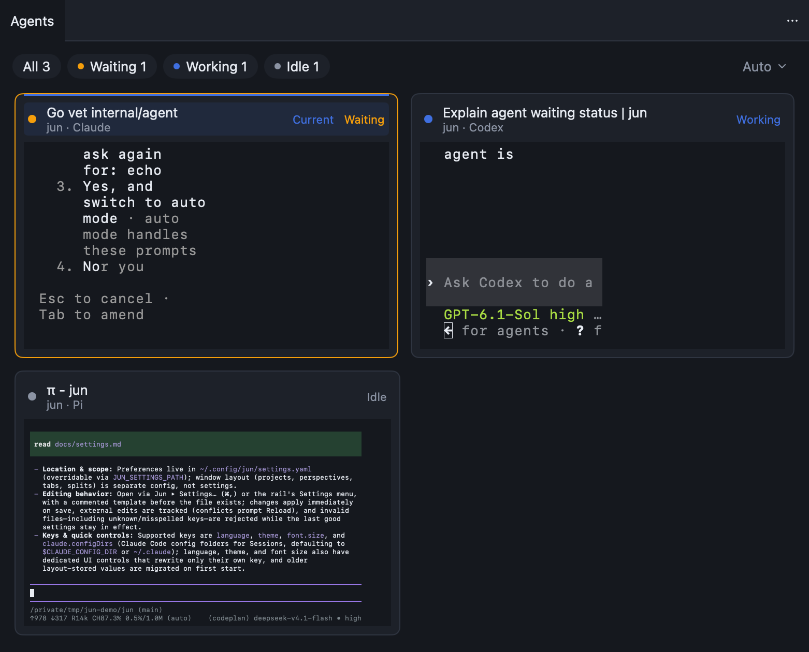
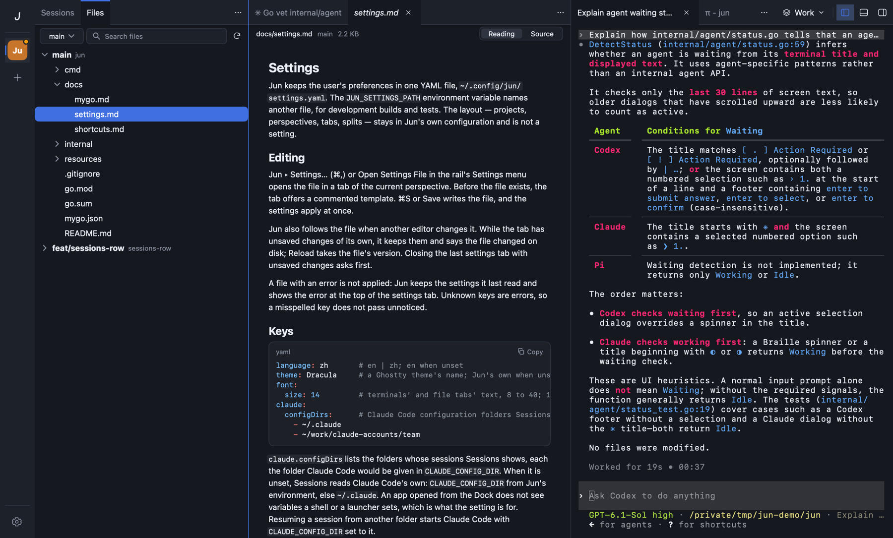
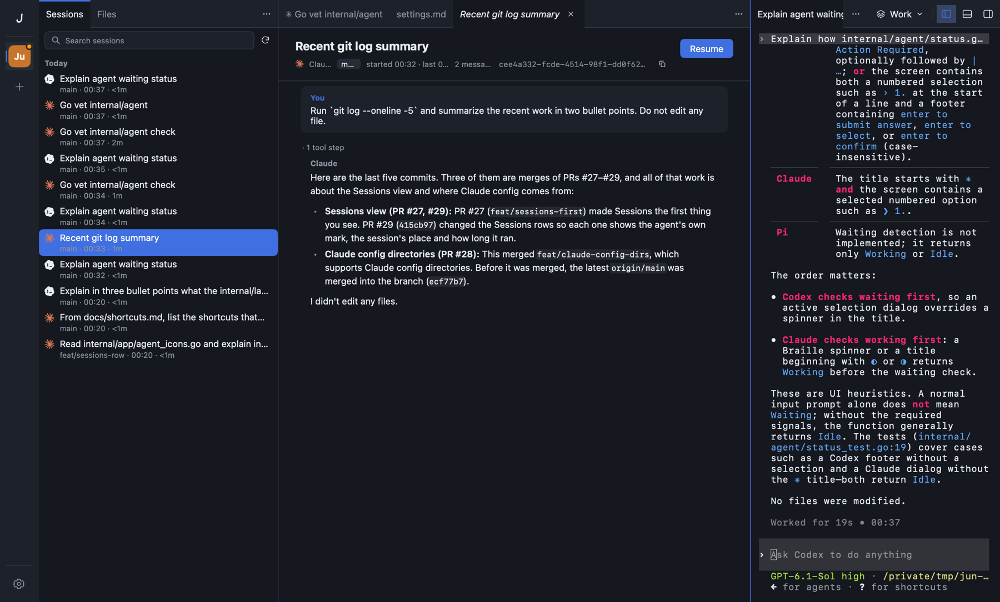
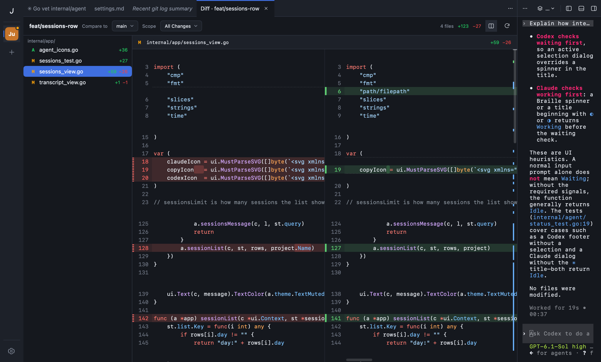

# Jun

A native macOS workspace for running terminal coding agents (Claude Code, Codex, Pi) side by side, across projects.

- **Platform**: Apple Silicon Mac, macOS 13 or later
- **Built with**: Go and [MyGo](https://github.com/egoist/mygo); terminals rendered on the GPU by Ghostty; no WebView
- **AI**: none of its own. Jun runs the agent CLIs you already have, and makes no AI API calls.
- **Status**: 0.1.0, the first release. Ad-hoc signed, with no automatic updates.



## Install

### Download

1. Download `jun-0.1.0-arm64.dmg` from [Releases](https://github.com/bencode/jun/releases/latest).
2. Open the DMG and drag **Jun** into **Applications**.
3. Open Jun the first time. It is ad-hoc signed, not notarized, so macOS asks first:
   - **macOS 13–14**: Control-click **Jun** in Applications → **Open** → **Open**.
   - **macOS 15 and later**: open Jun once and close the warning. Then go to **System Settings → Privacy & Security**, click **Open Anyway** next to Jun, and confirm.
   - **Or**, in a terminal: `xattr -dr com.apple.quarantine /Applications/Jun.app`

### Build from source

An app you build yourself opens without the warning.

- **Requires**: Go, Git, the Xcode command line tools, and access to `proxy.golang.org` and GitHub.
  - Go downloads the version that `go.mod` asks for (1.27.3) on the first build.

```sh
git clone https://github.com/bencode/jun.git
cd jun
go tool mygo build -platform darwin/arm64
```

- Then drag `build/darwin-arm64/Jun.app` into **Applications**.

### Optional: `jun` command

```sh
alias jun=/Applications/Jun.app/Contents/MacOS/Jun
```

- Add it to your shell's profile. Then `jun .` opens the current directory as a project.

## Quick start

1. **Open a project**: ⌘O, or drag a directory onto the project rail at the window's left.
2. **Open a terminal**: ⌘T.
3. **Run an agent** in it: `claude`, `codex` or `pi`.
4. **Watch your agents**: show Global with the rightmost switch at the top right. The **Agents** view lists every agent in every project, the ones waiting for you first.
5. **Look back**: **Sessions** in the side bar (⌘B) lists past sessions. ⌘⇧D reviews a branch's changes.

## Features

- **Projects and perspectives**: many projects in one window. Each has named layouts, such as Work and Review. → [Workspace](docs/workspace.md)
- **Layout**: one to three columns, a bottom region, the side bar and Global. Drag tabs between them. → [Workspace](docs/workspace.md)
- **Terminals**: Ghostty on the GPU. Shells keep running when their tab is closed or hidden, and can be reopened. → [Terminals](docs/terminals.md)
- **Agents**: Claude Code, Codex and Pi across all projects, as waiting, working or idle, with live cards of their screens. → [Agents](docs/agents-view.md)
- **Files**: the repository by branch and worktree, read-only, with Markdown and image previews. ⌘P searches it. → [Files](docs/files.md)
- **Sessions**: the project's Claude Code and Codex history. Read a session, or resume it in a terminal. → [Sessions](docs/sessions.md)
- **Diff**: a branch's changes, side by side or unified, to review an agent's work before its pull request. → [Diff](docs/diff.md)
- **Command palette**: ⌘K for commands, projects, perspectives and directories.
- **Keyboard**: shortcuts for tabs, regions, perspectives and projects. They are listed under **Keyboard Shortcuts** in ⌘K. → [Shortcuts](docs/shortcuts.md)
- **Themes**: Jun's own, or any Ghostty theme, including your own in `~/.config/ghostty/themes`.
- **Languages**: English and Simplified Chinese.
- **Settings**: one YAML file, opened in Jun with ⌘,. → [Settings](docs/settings.md)

| Agents | Files |
|---|---|
|  |  |
| **Sessions** | **Diff** |
|  |  |

## Configuration

| File | Holds | Default location | Override |
|---|---|---|---|
| `settings.yaml` | language, theme, text size, Claude Code folders | `~/.config/jun/settings.yaml` | `JUN_SETTINGS_PATH` |
| `config.json` | projects, perspectives, layout, tabs | `~/Library/Application Support/Jun/config.json` | `JUN_CONFIG_PATH` |

- **Sessions** reads Claude Code's sessions from `claude.configDirs` in the settings file, else from `CLAUDE_CONFIG_DIR`, else from `~/.claude`. It reads Codex's from `CODEX_HOME`, else from `~/.codex`.
- More: [Configuration](docs/configuration.md), [Settings](docs/settings.md).

## Limitations

- Apple Silicon Macs only.
- Ad-hoc signed and not notarized, so the first open needs the steps above. No automatic updates.
- Quitting Jun ends its shells. The next start opens fresh shells in the same tabs, without their earlier processes or output. The window's size and position are not saved.
- Agent status is read from each terminal's title and screen. A new version of an agent may show something Jun misses.
- Files and Diff are read-only.

## Development

- **Requires**: macOS 13 or later, the Xcode command line tools, Go 1.27.3 or later.
- Give development builds their own files, so they do not share a layout or settings with the installed app:

```sh
JUN_CONFIG_PATH="$PWD/priv/config.dev.json" JUN_SETTINGS_PATH="$PWD/priv/settings.dev.yaml" go run ./cmd/jun
go test ./...
go vet ./...
go tool mygo build -platform darwin/arm64   # build/darwin-arm64/Jun.app and the DMG
```

| Package | Does |
|---|---|
| `cmd/jun` | the application's entry point |
| `internal/app` | the native UI: regions, views, palette, menus, saving |
| `internal/layout` | the model of projects, perspectives, regions and tabs, and its validation |
| `internal/config` | the layout file: versions, migrations, atomic writes |
| `internal/settings` | the settings file |
| `internal/terminal` | terminal sessions and their lifecycle |
| `internal/agent` | recognizing agents and reading their status |
| `internal/history` | reading Claude Code, Codex and Pi sessions |
| `internal/repo` | Git: branches, worktrees, files and diffs |
| `internal/theme` | Jun's colors, and Ghostty's themes |

- `priv/` holds local plans, notes and builds. It is ignored by Git, as are `.mygo/` and `build/`.
- The MyGo dependency and its fork: [docs/mygo.md](docs/mygo.md).

## Docs

| Page | Covers |
|---|---|
| [Workspace](docs/workspace.md) | projects, perspectives, regions, tabs and focus |
| [Terminals](docs/terminals.md) | shells, background sessions, quitting and restarting |
| [Agents](docs/agents-view.md) | recognition, status, cards and list, actions |
| [Files](docs/files.md) | the tree, previews, ⌘P search |
| [Sessions](docs/sessions.md) | which sessions, the list, reading and resuming |
| [Diff](docs/diff.md) | opening a diff, what it compares, reading it |
| [Configuration](docs/configuration.md) | the layout file: what it saves, how, and what happens on errors |
| [Settings](docs/settings.md) | the settings file and its keys |
| [Shortcuts](docs/shortcuts.md) | every keyboard shortcut |
| [MyGo](docs/mygo.md) | the MyGo dependency and its fork |
