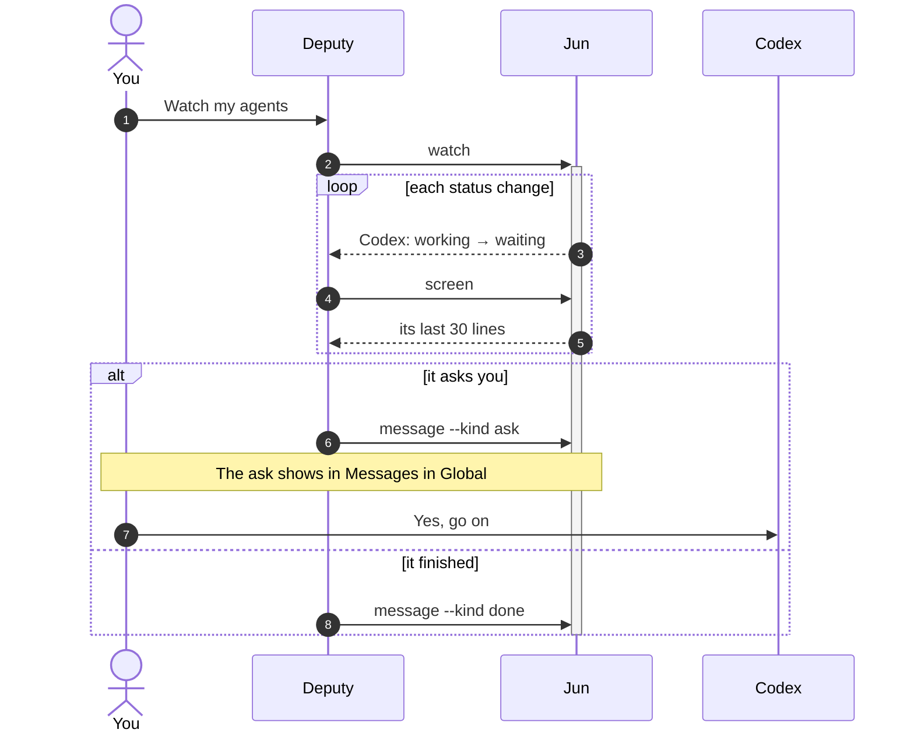
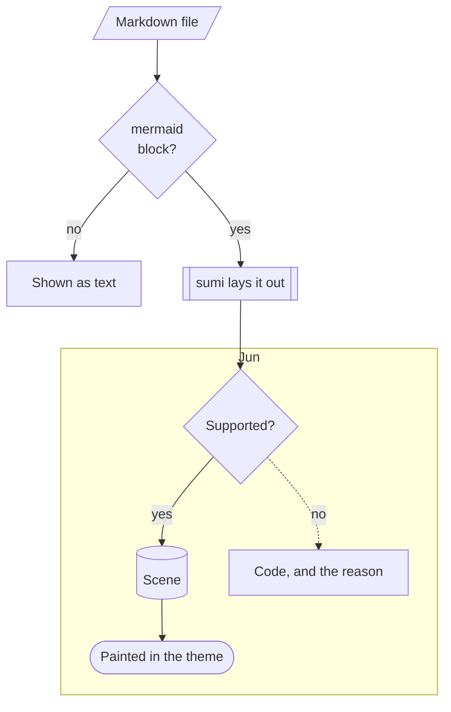
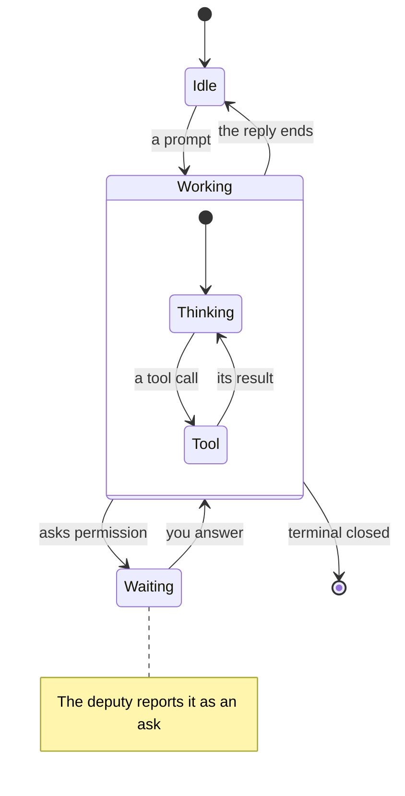
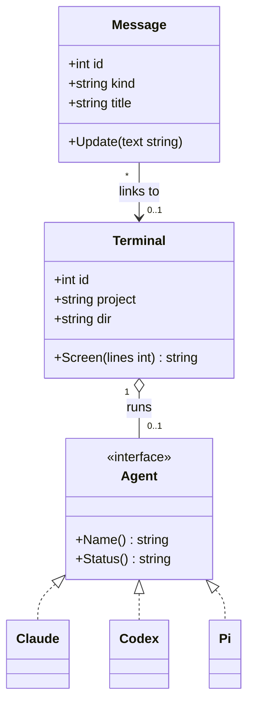
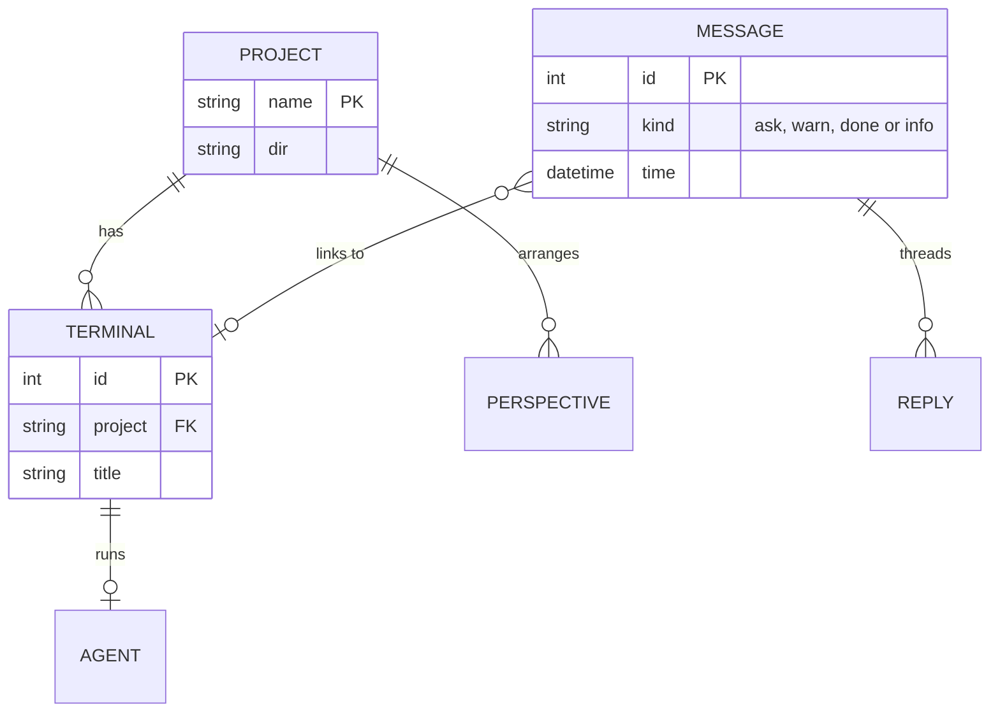
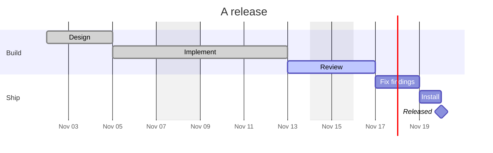
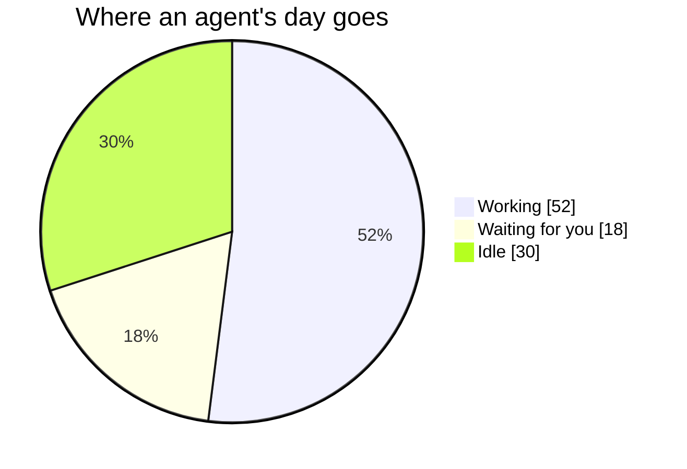

# Diagrams

A Markdown file shows each ` ```mermaid ` code block as a diagram. Jun draws it itself, with [sumi](https://github.com/bencode/sumi), a Go implementation of Mermaid's layout: no browser, no JavaScript. Open this page in Jun's [Files](files.md) to see every diagram below drawn.

| Diagram | Starts with |
|---|---|
| [Sequence](#sequence) | `sequenceDiagram` |
| [Flowchart](#flowchart) | `flowchart`, `graph` |
| [State](#state) | `stateDiagram`, `stateDiagram-v2` |
| [Class](#class) | `classDiagram`, `classDiagram-v2` |
| [Entity relationship](#entity-relationship) | `erDiagram` |
| [Gantt](#gantt) | `gantt` |
| [Pie](#pie) | `pie` |

- **Colors** follow Jun's theme, light or dark.
- **Size**: a diagram is drawn as Mermaid lays it out, made smaller to fit the [reading width](files.md), never larger. A Gantt chart is laid out as wide as the reading width.
- **Not drawn**: a block sumi cannot draw stays code, with the reason below it. So does a block still being written, until its closing fence.
- **Not yet**: other diagram types, such as Git graphs, mind maps, timelines and user journeys, and LaTeX math. sumi's [feature checklist](https://github.com/bencode/sumi/blob/main/docs/compatibility.md) lists what each type draws.

## Sequence

Participants and actors, activations, notes, numbering, and `loop`, `alt`, `opt`, `par` and `critical` blocks.



## Flowchart

Four directions, the classic shapes, labeled and dotted links, and subgraphs.



## State

Start and end, transitions with labels, composite states, and notes.



## Class

Members and methods, annotations, inheritance, realization, and associations with multiplicities.



## Entity relationship

Entities with attributes, keys and comments, and every cardinality.



## Gantt

Sections, dependencies, done and active tasks, milestones, and skipped weekends.



## Pie

A title, slices, and their values with `showData`.


